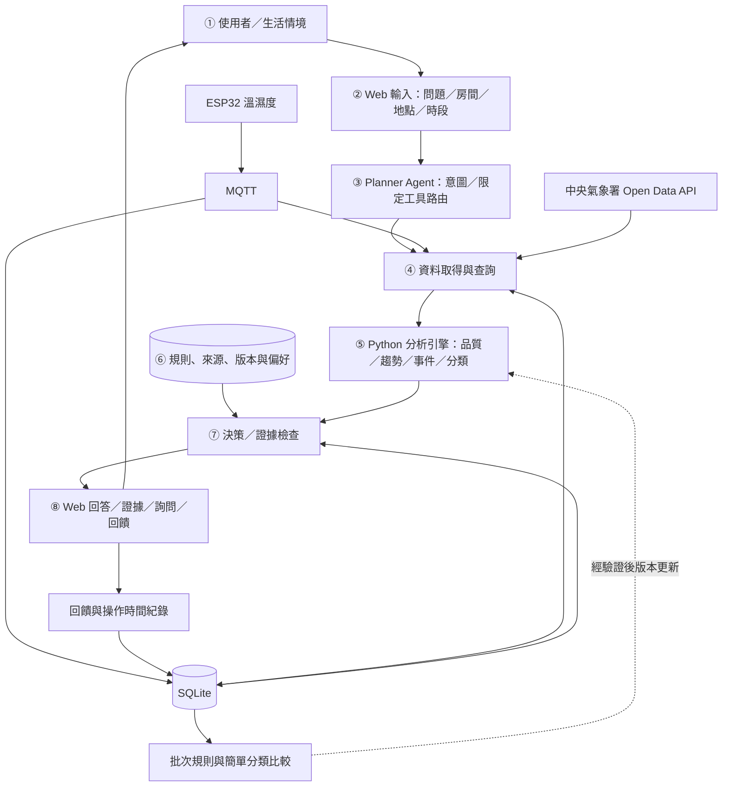
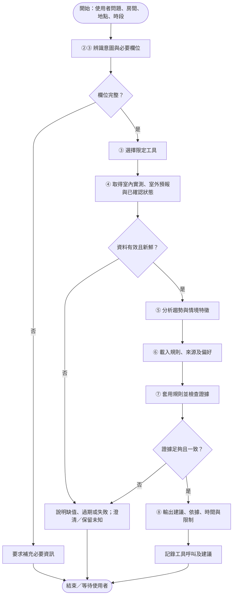
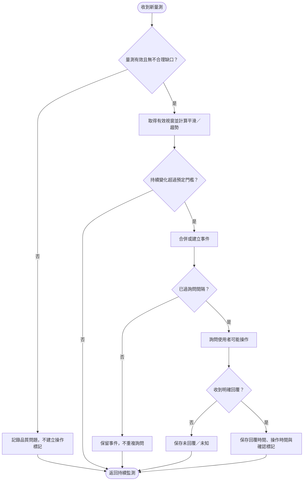

# DESIGN.md — 居家環境與外出建議代理人

> **文件階段：Proposal／預定系統設計（尚未完成實作）**  
> **專題名稱：** 居家環境與外出建議代理人（Home Environment & Outing Recommendation Agent）  
> **組員：** 高群軒、鍾易憲、蕭程勻  
> **文件日期：** 2026-11-04  
> **設計依據：** 本組《居家環境與外出建議代理人—期末專題提案簡報》及課程《Final Project Proposal Requirements》

## 0. 文件目的與狀態

本文件記錄 Proposal 階段可供審查與後續開發的**預定設計**，說明問題、需求、系統架構、模組介面、資料流程、領域知識、核心演算法、驗證方法與限制。本文的流程圖、資料欄位、介面契約及偽程式碼是設計規格，**不表示已完成部署、訓練、測試或取得實驗結果**。實作時應在 GitHub 持續更新本文件，並記錄任何偏離提案的決策。

### 0.1 一句話摘要

以單一房間的 ESP32 溫濕度實測資料、中央氣象署對應地點／時段的預報及使用者操作回饋，建立可查證依據的 Domain AI Agent，提供**室內設備使用、外出安排、室內外曬衣**建議，並探索環境變化事件能否協助辨識設備操作。

### 0.2 範圍邊界

**第一版包含：** 單房間溫度與相對濕度量測；室外預報查詢；來源／時間／地點對齊；資料品質檢查；趨勢與事件分析；規則優先的生活建議；受限工具路由的 LLM 解釋；異常詢問、使用者確認與未知標記；規則與簡單分類器的實驗比較。

**第一版不包含：** 自動控制冷氣或除濕機；節能最佳化；多房間部署；完整熱舒適度診斷；以兩個感測值斷言設備已開啟；精確預測衣物乾燥時間；在資料不足時宣稱模型有效。

---

## 1. Problem — 問題與研究動機

### 1.1 使用者與情境

主要使用者為單一房間的一般居家使用者。人在室內時，通常能直接感受房間狀態，卻仍需要另外查詢室外天氣；室內實測與室外預報的**地點、時間、資料性質**不同，不能直接混為同一筆環境量測。設備操作、開窗、活動及個人偏好也可能改變室內溫濕度或對舒適度的主觀感受。

### 1.2 核心問題

1. 如何整合**室內實測**與**室外預報**，在設備、外出與曬衣情境中提供有依據的生活建議？
2. 當室內環境出現持續變化時，何時應詢問使用者是否操作設備，而不是直接推斷原因？
3. 少量且有不確定性的使用者回饋，能否改善操作事件辨識，同時控制詢問負擔？

### 1.3 Research Gap 與設計主張

所選研究分別探討工具互動、智慧家居偏好、活動辨識、室內佔用及熱舒適；尚不能直接替代**本房間的溫濕度與設備操作真值**。本專題採取「規則優先、回饋輔助、證據可追溯、未知可保留」的設計，不主張全球首創，也不把相關性視為因果證明。

---

## 2. Requirements — 需求與驗收準則

### 2.1 功能需求

| ID | 需求 | 預定驗收方式 |
|---|---|---|
| FR-01 | 擷取單房間 ESP32 溫濕度與量測時間 | 一筆真實讀值可經 MQTT 保存並查詢 |
| FR-02 | 取得指定外出／曬衣地點與時段的中央氣象署預報 | 回傳預報地點、適用時段、取得時間與可用來源資訊 |
| FR-03 | 對量測與預報做有效性、新鮮度與缺值檢查 | 過期／斷線／API 失敗時不產生無依據的肯定判斷 |
| FR-04 | 提供室內設備、外出與曬衣建議 | 三類情境可呈現依據、條件及限制 |
| FR-05 | 分析溫濕度趨勢並偵測持續變化事件 | 短暫跳點、連續事件與斷線恢復有不同處理 |
| FR-06 | 事件發生時，依詢問間隔向使用者確認操作 | 可記錄詢問、回覆、未回覆與時間 |
| FR-07 | 保存確認操作、混合操作與未知標記 | 不把未回覆當作「沒有操作」 |
| FR-08 | 使用限定工具完成查詢與回答 | 工具呼叫與最終回答能對照來源證據 |
| FR-09 | 比較固定規則與簡單分類模型 | 以完整事件／時間切分，報告各類指標與限制 |

### 2.2 非功能需求

| 面向 | 設計要求 |
|---|---|
| 可追溯性 | 建議保存來源、量測／預報時間、規則 ID／版本及工具呼叫紀錄 |
| 正確性 | 程式執行數值計算；LLM 不自行編造讀值、時間、設備狀態或氣象資訊 |
| 可解釋性 | 顯示觸發條件、設備已知狀態與未量測因素 |
| 可靠性 | 斷線、缺值、過期、API 錯誤時澄清、降級或保留未知 |
| 使用者負擔 | 合併同一事件並設定詢問間隔，記錄詢問頻率與回覆率 |
| 可維護性 | 規則、資料欄位、模型與工具介面具版本資訊；實作與文件同步 |
| 隱私 | 儘量只保存專題所需環境資料與使用者操作標記；存取控制與保留期限於實作前確認 |

> **待決參數：** 量測頻率、資料新鮮度時限、平滑視窗、事件變化門檻、詢問冷卻間隔及分類器最低標記量，簡報未指定確切數值；實作期應在訓練資料或開發測試中設定、記錄版本，不得使用最終測試集反覆調整。

---

## 3. Architecture — 系統架構

### 3.1 八個核心模組

| 編號 | 模組 | 責任與預定技術 |
|---|---|---|
| ① | User / Application Scenario | 單房間設備、外出、室內外曬衣情境 |
| ② | Query / Input | Web 接收問題、房間、目的地、時段與使用者回饋 |
| ③ | Planner & Reasoning Agent | LLM 分解意圖、補問缺值、選擇**允許的**查詢工具 |
| ④ | Data Acquisition / Retrieval | ESP32、MQTT、中央氣象署 API、SQLite |
| ⑤ | Analytics Engine | Python 品質檢查、平滑、斜率、事件與簡單分類 |
| ⑥ | Domain Knowledge Integration | 有來源與版本的領域規則、偏好與限制 |
| ⑦ | Decision / Recommendation | 核對證據、設備確認狀態、未知情形，產生候選建議 |
| ⑧ | Output & Interaction | Web 顯示回答、來源時間、事件曲線、詢問與回覆 |

### 3.2 System Architecture Diagram



**設計解讀：** ③ 負責選工具與說明，⑤ 負責數值計算，⑦ 負責規則及證據約束；LLM 不能繞過品質檢查直接把預測或感測趨勢說成確定事實。系統第一版**只提供建議，不直接控制家電**。

### 3.3 元件責任與介面邊界

| 元件 | 輸入 | 輸出 | 失敗處理 |
|---|---|---|---|
| 感測資料接收器 | ESP32 溫濕度訊息 | 時戳量測、品質旗標 | 缺值、異常與斷線紀錄 |
| 氣象資料工具 | 行政區／地點、目標時段 | 預報快照、適用時間、來源 | 無法取得則回報不可用 |
| 事件分析工具 | 有效歷史量測視窗 | 趨勢特徵、候選事件 | 時間缺口不視為設備操作 |
| 設備狀態查詢 | 已確認操作日誌 | 最近可確認狀態及時間 | 無可靠狀態則回傳 unknown |
| 領域規則工具 | 情境、數值、偏好 | 規則命中、建議候選、rule_id | 不符合前提則不觸發 |
| 回答產生器 | 候選建議、證據 | 文字回答及證據清單 | 證據不一致時改用模板 |
| 回饋紀錄器 | 事件 ID、回覆、操作時間 | 確認／混合／未知標記 | 保留未回覆與不確定性 |

---

## 4. Data — 資料來源、欄位與資料流

### 4.1 資料來源

| 來源 | 預定內容 | 用途 | 重要限制 |
|---|---|---|---|
| ESP32 + 溫濕度感測器 | 單房間溫度、相對濕度、時間 | 當下狀態與近期趨勢 | 只有兩種環境量，不能直接判斷原因 |
| 中央氣象署 Open Data API | 目的地、預報時段、氣溫、濕度、降雨等可用欄位 | 外出／戶外曬衣 | 區域預報非房間實測，欄位依產品回傳為準 |
| 使用者回饋／主動操作紀錄 | 設備／開窗／混合／無操作、回覆與操作時間 | 事件標記及模型比較 | 自述可能延遲或不確定 |
| SQLite | 量測、快照、事件、詢問、回覆、規則與版本 | 查詢、追溯、評估 | 資料表為預定設計，非已建置 |
| UCI Occupancy Detection | 公開室內量測及佔用標記 | 前處理／圖表流程驗證 | **佔用標記不可當家電操作標記** |

### 4.2 建議資料結構（Proposal 草案，非已定案 Schema）

| 邏輯資料表 | 核心欄位（示意） | 設計目的 |
|---|---|---|
| `measurements` | `measurement_id`, `room_id`, `measured_at`, `temperature_c`, `relative_humidity_pct`, `quality_flag` | 保存室內實測與有效性 |
| `forecast_snapshots` | `snapshot_id`, `location_id`, `retrieved_at`, `issued_at?`, `valid_from`, `valid_to`, `forecast_payload`, `source` | 保存對應地點／時段及原始快照；`issued_at` 只有來源提供才填 |
| `events` | `event_id`, `room_id`, `start_at`, `end_at?`, `features`, `quality_flag`, `event_version` | 合併持續變化事件 |
| `feedback` | `feedback_id`, `event_id?`, `asked_at?`, `replied_at?`, `operation_at?`, `operation_label`, `certainty` | 區分詢問、操作時間與未知 |
| `recommendations` | `recommendation_id`, `query_time`, `intent`, `evidence_refs`, `rule_ids`, `output`, `status` | 回溯建議依據 |
| `model_runs` | `model_version`, `train_period`, `test_period`, `metrics`, `rule_version` | 保存模型比較及版本 |

`?` 表示可能缺值，**不可用推測值填補來源沒有提供的發布時間**。各欄位型別、索引、資料庫正規化及實際表名在實作時再確認。

### 4.3 資料品質與時空對齊

- 室內使用**實際量測時間與房間識別**；室外使用**查詢地點、預報適用時段與取得時間**，兩者不可混稱同一時刻的實測。
- 先驗證缺值、數值合理性、時間順序、資料缺口與新鮮度，再做趨勢分析；斷線後恢復不直接建立操作標記。
- 量測、使用者自述、模型推論各自保存，不互相覆寫。一般時段與主動操作也要記錄，避免資料只包含被觸發詢問的異常樣本。
- 自蒐資料**預計連續約兩週**；實際量測筆數、有效事件數與類別分布以後續實測為準。

---

## 5. AI / Analytics — 代理人、分析與模型設計

### 5.1 工具受限的 Domain AI Agent

代理人辨識意圖（設備／外出／曬衣／事件查詢），確認必要地點及時段，依需求選擇允許的資料工具。**數值分析、門檻判定與事件分類交由 Python 程式執行**；LLM 用於意圖理解、工具路由、追問與自然語言解釋。回答必須能對應到讀值、時間、來源、規則及設備狀態；不一致時降級為可驗證的模板回答。

### 5.2 趨勢與事件偵測

1. 讀取有效量測時間窗，必要時平滑溫濕度序列。
2. 擷取溫度、RH、變化斜率及可選的露點等特徵；露點僅輔助解讀水氣，不能證明設備操作。
3. 以**持續變化**而非單一跳點建立候選事件；合併同一持續事件。
4. 若超過詢問冷卻間隔，向使用者詢問可能的操作；未回覆保留 `unknown`。
5. 以操作日誌和使用者確認作標記，保留混合操作與不確定性。

### 5.3 規則基準與簡單分類器

- **Baseline：** 固定變化規則；初步比較操作／無操作，再視有效樣本量探索冷氣、除濕、混合操作、開窗等類別。
- **候選模型：** 簡單決策樹（提案指定），使用事件發生當下及之前可取得的特徵。
- **切分方式：** 以完整事件及時間切分，保留較晚事件作測試；同一事件的相近讀值不得跨訓練與測試。
- **更新策略：** 批次更新、版本化；標記不足、類別失衡或未能證明改善時，保留規則方案。

---

## 6. Domain Knowledge — 領域知識與規則

| 規則 ID（草案） | 條件／領域依據 | 預定回應 | 限制 |
|---|---|---|---|
| DK-01 | RH 持續偏高；EPA 建議室內 RH 盡可能低於 60% [7] | 結合趨勢與已知設備狀態，提供可調整的除濕建議 | 60% 為參考，非完整舒適或問題診斷 |
| DK-02 | 溫度升高且 RH 下降；RH 與露點代表不同概念 [8] | 同時解讀溫度與水氣變化 | **不得直接判定除濕機開啟** |
| DK-03 | 使用者感覺悶熱；熱舒適受多項環境與個人因素影響 [4][6] | 詢問偏好、說明限制並提供一般設備建議 | 未量測風速、輻射、衣著與活動 |
| DK-04 | 目的地／時段預報有降雨可能 [9][10] | 對外出或戶外曬衣提出條件式建議 | 預報不等於實際降雨 |
| DK-05 | 室內晾衣情境 | 合併室內溫濕度、通風及衣物條件提出選項 | 第一版**不預測乾燥時間** |

規則需保留 `rule_id`、來源、版本、適用前提及可能衝突；偏好是補充資訊，不能覆蓋資料品質檢查。

---

## 7. Flowcharts — 完整處理流程

### 7.1 Flowchart A：生活建議查詢



### 7.2 Flowchart B：背景監測與回饋



**例外處理：** 連線中斷、API 不可用、預報不適用目標地點／時段、設備狀態未知、同時操作多設備、資料時間不一致，都應保留限制或要求澄清；不得強制選一個看似合理的答案。

---

## 8. Algorithms — 核心偽程式碼

### Algorithm 1：查詢與建議（預定演算法）

```text
Input : Query Q, Room R, Destination L, Time H
Output: Recommendation A with Evidence E

01  intent, missing = parse_input(Q, R, L, H)             // ②③
02  if missing: return ask_for_missing_fields(missing)
03  plan = select_allowed_tools(intent)                   // ③
04  D = fetch_required_sources(plan, R, L, H)            // ④
05  if invalid_or_stale(D): return explain_data_limit(D)
06  X = preprocess_and_analyze(D)                         // ⑤
07  K = retrieve_rules_and_preferences(intent)            // ⑥
08  S = load_recent_confirmed_device_state(R)
09  C = apply_rules(X, K, S)                              // ⑦
10  E = collect_values_times_sources_and_rule_ids(D, X, K)
11  if evidence_incomplete(C, E): return clarify_or_abstain(E)
12  A = generate_explanation(Q, C, E)                     // ⑧
13  if not evidence_consistent(A, E):
14      A = template_answer(C, E)
15  log_tools_and_recommendation(plan, A, E)
16  return A, E
```

### Algorithm 2：事件與回饋（預定演算法）

```text
Input : Measurement Stream M, Feedback F
Output: Event Log V and Labeled Events Y

01  for each measurement m in M:
02      if invalid_or_gap(m): log_quality(m); continue
03      W = recent_valid_window(m.time)
04      X = smooth_and_extract_trends(W)
05      if not sustained_change(X): continue
06      e = merge_or_create_event(X, m.time)
07      if question_interval_passed(e): ask_user_about_change(e)
08  for each feedback f in F:
09      save_reply_time_and_operation_time(f)
10      if uncertain_or_missing(f): keep_unknown(f); continue
11      link_confirmed_label_to_event(f)                  // ④⑧
12  when scheduled_update and labels_sufficient(Y):
13      train, test = split_by_event_and_time(Y)
14      model = fit_simple_classifier(train, features_before_event_time)
15      compare_to_rules(model, test)
16      version_and_log(model)
```

**設計約束：** 未回覆不是無操作；同時開啟冷氣與除濕機保留混合操作；特徵不可包含事件後才知道的資訊；評估不足時不宣稱分類器優於規則。

---

## 9. Evaluation — 實驗設計與驗收

| 研究問題 | 比較組 | 預定指標 | 主要情境 |
|---|---|---|---|
| 回饋是否協助辨識操作？ | 固定規則 vs. 簡單決策樹 | 各類事件數、precision、recall、macro-F1、混淆矩陣 | 冷氣、除濕、混合操作、開窗、無操作 |
| 如何降低重複或無效詢問？ | 基礎詢問 vs. 事件合併＋詢問間隔 | 每小時詢問數、回覆率、事件重複詢問率、使用者感受 | 事件延續、短暫跳點、未回覆、修正 |
| 代理人是否依據證據回答？ | 固定規則模板 vs. LLM 工具代理人 | 工具選擇正確率、證據一致率、缺資料恰當澄清率、延遲 | 室內外反差、曬衣、設備已開、API 失敗、過期快照 |

### 9.1 評估原則

- 自蒐約兩週資料，按**完整事件與時間**切分；訓練期設定門檻，測試集使用後不再調參。
- 依實際操作日誌與使用者確認標記，保留標記不確定性；報告每類樣本數、指標定義與分母。
- 不只報 accuracy；樣本不足、類別失衡或回覆稀少時，僅報告探索性結果。
- 同一批情境對照固定模板與代理人，逐項檢查數值、來源、時間、設備狀態及適當拒答。
- **Proposal 階段沒有實測結果，亦不預先承諾任何準確率或改善百分比。**

### 9.2 Proposal 階段可驗收交付物

- [x] 系統範圍、研究問題、需求與模組分工已定義
- [x] 八模組架構圖、兩條流程圖、兩段有編號的偽程式碼
- [x] 資料來源、領域規則、實驗設計、指標及限制已記錄
- [ ] ESP32 真實量測與 MQTT／SQLite 串接（提案後實作）
- [ ] 氣象署 API 與 Web／Agent 整合（提案後實作）
- [ ] 事件標記、分類比較及正式實驗結果（提案後實作）

---

## 10. Implementation Mapping — 實作規劃與分工

### 10.1 三條工作流（提案中的 A／B／C 角色，未指定個人對應）

| 工作流 | 預定負責範圍 | 整合交付 |
|---|---|---|
| A 感測與資料 | ESP32、溫濕度模組、MQTT、SQLite、資料品質 | 可持續收集的資料與操作日誌 |
| B 分析與模型 | 氣象署介接、趨勢／事件規則、回饋資料與評估 | 分析工具、規則基準與分類比較 |
| C 代理人與介面 | 工具路由、Web、證據呈現、異常詢問與回覆 | 可操作的對話與回饋流程 |

三人共同負責文獻核對、架構設計、整合測試與口頭報告。**簡報只定義 A／B／C 工作流，未指派具名組員，因此本文件不擅自指定姓名。**

### 10.2 提案後四週里程碑（相對週次）

| 週次 | 預定工作 | 可驗證產物 |
|---|---|---|
| 第 1 週 | 硬體量測、資料欄位、氣象署快照 | 一筆真實感測資料可保存並呈現 |
| 第 2 週 | 串接建議、異常詢問、持續蒐集 | 一個事件能連結詢問與回覆 |
| 第 3 週 | 整理標記、規則與分類比較 | 切分紀錄、事件數與評估指標 |
| 第 4 週 | 整合失敗案例、文件及展示 | 重現步驟、限制及 Demo |

實際日期依課程時程調整；上述是**Proposal 繳交後**的實作安排，不是已完成進度。

### 10.3 建議 Repository 組織（規劃，不代表檔案已存在）

```text
project-root/
├── README.md                 # 專題介紹、安裝、執行與 Demo（後續補齊）
├── DESIGN.md                 # 本設計文件
├── docs/                     # Proposal、架構與評估文件
├── firmware/                 # ESP32 感測程式
├── src/
│   ├── acquisition/          # MQTT、氣象資料取得
│   ├── analytics/            # 品質、趨勢、事件與分類
│   ├── agent/                # 工具路由、證據檢查、回答
│   ├── knowledge/            # 規則、來源、版本與偏好
│   └── web/                  # Web 查詢與回饋介面
├── tests/                    # 情境、單元與整合測試
└── experiments/              # 基準比較、指標與版本紀錄
```

目錄名稱是**文件整理建議**，可依實際技術選型調整；此處不承諾特定 Web 框架、LLM 供應商、MQTT Broker 或感測器型號。

---

## 11. Limitations, Risks & Design Decisions — 限制與待確認事項

| 風險／限制 | 預定對策 |
|---|---|
| 只有溫度與 RH，不能完整判斷舒適度 | 告知未量測風速、輻射、衣著與活動等因素 |
| 溫濕度變化可能由多種原因造成 | 不直接推論設備開關；以使用者確認補充 |
| 使用者未回覆或回覆不確定 | 標記 unknown，不當作負類 |
| 多設備同時操作 | 保留混合操作，不強迫單標籤 |
| 事件樣本少、分布不均 | 規則優先、完整報告樣本數與探索性限制 |
| 室外預報有地點／時段誤差 | 顯示適用地點、時間、取得時間與限制 |
| 斷線與 API 失敗 | 資料品質檢查、澄清、降級或拒絕斷言 |
| LLM 幻覺或選錯工具 | 限定工具、程式計算、證據檢查、模板回退 |
| 詢問造成使用者負擔 | 事件合併、詢問間隔及回覆率評估 |

**待實作確認：** 感測器型號與校正方式、MQTT Broker、氣象署預報產品及欄位映射、API 存取設定、資料保留與隱私政策、事件門檻、模型特徵與最低樣本數、實際部署／執行指令。這些內容尚無 Proposal 佐證，不在本文件中虛構成既定規格。

---

## 12. References — 提案引用來源

以下沿用本組簡報的參考文獻編號；引用內容及文獻比較以原 Proposal 為準，並非本文件額外完成的獨立文獻查核。

1. [1] Yao et al. (2023). *ReAct*. ICLR. https://arxiv.org/abs/2210.03629
2. [2] Lim et al. (2026). *AdaHome*. Preprint. https://arxiv.org/abs/2607.18034
3. [3] Leng et al. (2025). *AgentSense*. arXiv v4. https://arxiv.org/abs/2506.11773
4. [4] Mishra & Bean (2026). *Dispelling Thermal Comfort Myths, Part 1*. ASHRAE Journal（原簡報列為官方文章）。
5. [5] Candanedo & Feldheim (2016). *Occupancy Detection*. UCI. https://archive.ics.uci.edu/dataset/357/occupancy-detection
6. [6] Tartarini et al. (2020). *CBE Thermal Comfort Tool*. SoftwareX 12, 100563. https://ashrae55.berkeley.edu/
7. [7] US EPA. *A Brief Guide to Mold, Moisture and Your Home*. https://www.epa.gov/mold/brief-guide-mold-moisture-and-your-home
8. [8] NOAA/NWS. *Dew Point vs. Humidity*. https://www.weather.gov/arx/why_dewpoint_vs_humidity
9. [9] 中央氣象署（2024-12-10）。*368 鄉鎮預報產品說明*。https://www.cwa.gov.tw/Data/data_catalog/1-1-1.pdf
10. [10] 中央氣象署。*開放資料 API*。https://opendata.cwa.gov.tw/dist/opendata-swagger.html
11. [11] 課程 *Final Project Proposal Requirements*. https://lms2020.nchu.edu.tw/course/homework/74762

---

## 13. 文件演進與交接

**Proposal（目前）：** 定義問題、需求、架構、元件、資料、規則、演算法、流程圖、驗證計畫與限制。  
**實作期間：** 更新實際模組／介面、Schema、規則版本、模型版本、例外處理、執行與測試方式。  
**Final Handover：** 補上可重現的執行步驟、真實結果、比較、失敗案例、限制與未來工作，讓下一位開發者能透過 GitHub、README.md 與 DESIGN.md 理解並延續專題。

> **文件維護原則：** 任何完成狀態、效能數值、技術選型或驗證結論，均須以實際程式、日誌、測試或實驗報告為依據後才能更新。
